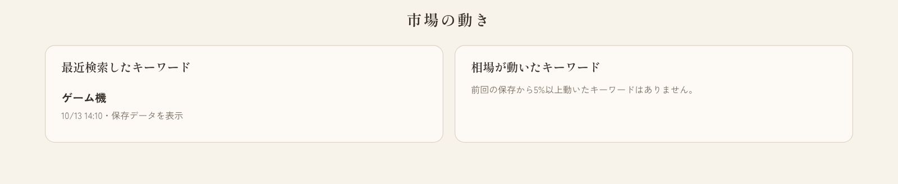
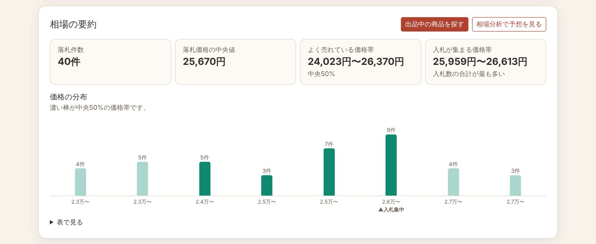
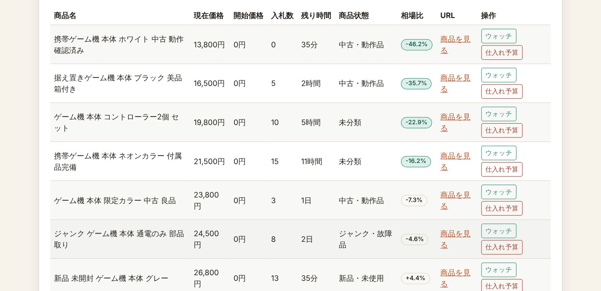
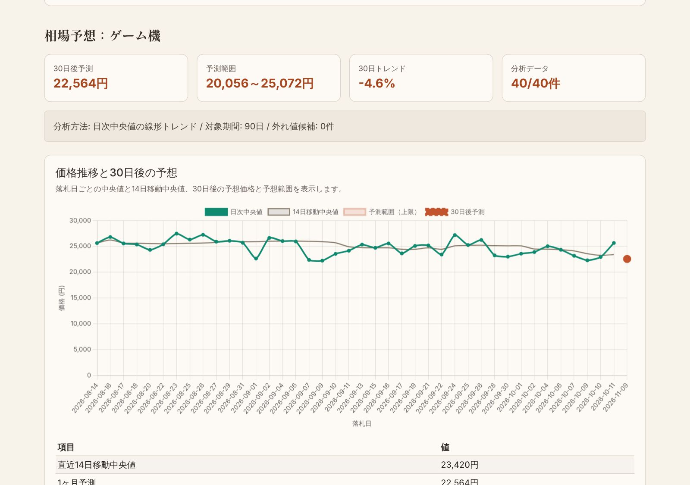
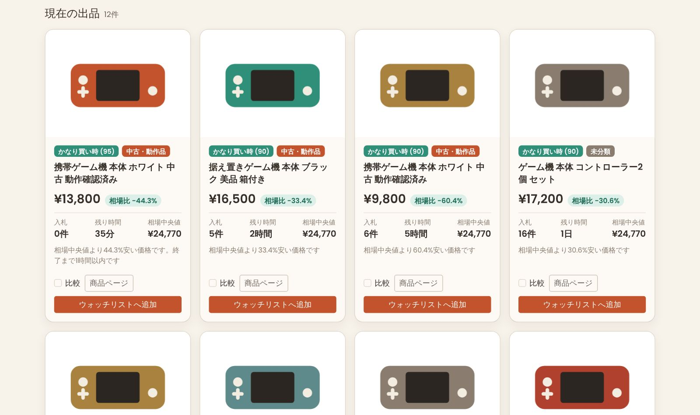
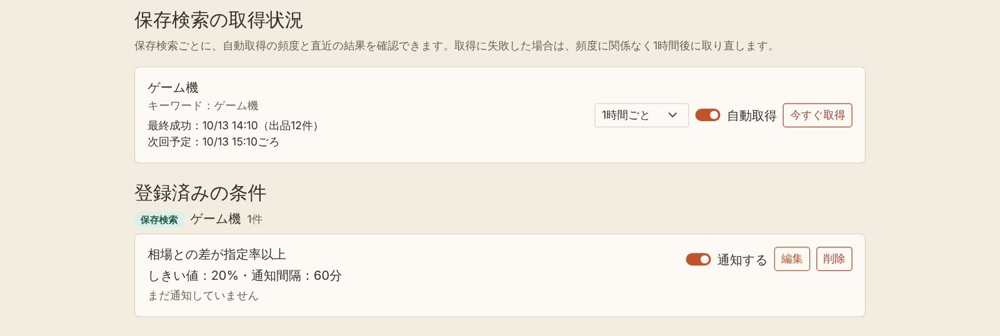
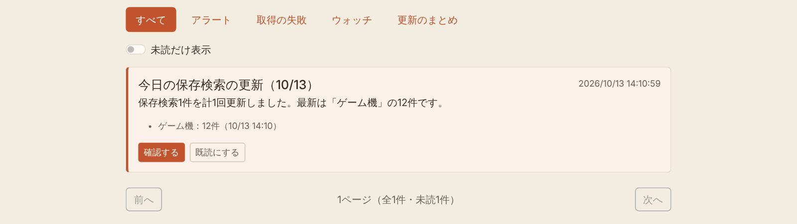

# 画面・機能ガイド

ヘッダーのメニューから各画面へ移動します。ログインすると、出品・在庫管理、販売実績分析、アラート、通知、ユーザーページも使えます。

## 画面一覧

| 画面 | URL | 主な用途 |
|---|---|---|
| ホーム | `/taskle/` | おすすめ商品、市場の動き、各機能への入口 |
| 市場検索 | `/taskle/market-search` | 落札相場・現在出品・保存済みデータの検索と相場の要約 |
| 相場分析 | `/taskle/Deep_Analysis` | 保存データの概要と30日後の相場予想 |
| ターゲット分析 | `/taskle/Deep_Analysis_now` | 落札相場と現在の出品を比べた狙い目商品、ウォッチリスト、仕入れ予算 |
| 出品・在庫管理 | `/taskle/seller-management` | 仕入れた商品と自分の出品の管理、販売結果の確定 |
| 販売実績分析 | `/taskle/seller-outcomes` | 確定した販売結果の集計 |
| アラート | `/taskle/alerts` | 保存検索の取得状況と通知条件の管理 |
| 通知 | `/taskle/notifications` | アラートや取得結果の確認 |
| このツールについて | `/taskle/introduction` | 機能紹介 |
| ユーザーページ | `/accounts/profile/` | 検索履歴、保存検索、パスワード変更 |
| 開発者画面 | `/taskle/developer/` | 管理者向けのデータ件数・エラー・ログ確認 |

以前の相場予想ページ（`/taskle/Yahuoku_prediction`）は相場分析に統合しました。古いリンクは相場分析の「新しいキーワード」タブへ移動します。

## ホーム

ログイン中は次の3つを表示します。

- **あなたへのおすすめ**: ターゲット分析で保存した条件の取得結果から、買い時の商品を最大12件カードで表示します。
- **市場の動き**: 最近検索したキーワードと、前回の保存から落札中央値が5%以上動いたキーワードを表示します。クリックすると市場検索の結果がそのまま開きます。保存データだけを使うので、ホームを開いてもYahoo!オークションへはアクセスしません。
- **機能一覧**: 市場検索・相場分析・ターゲット分析と、ログイン中に使える各画面への入口です。

## 市場検索

「落札相場」「現在価格」「保存済みデータ」の3つのモードを同じ画面で切り替えます。価格の範囲、商品状態、並び順で絞り込めます。

検索すると結果の上に **相場の要約** を表示します。表示中の行から計算するので、絞り込むと要約も変わります。

- 落札相場・保存済みデータ: 落札件数、中央値、よく売れている価格帯（中央50%）、入札が集まる価格帯、価格の分布
- 現在価格: 出品中の件数、現在価格の中央値、落札相場の中央値、相場より15%以上安い出品の件数

現在価格モードでは、各行の **相場比** が保存済みの落札相場の中央値との差を示します。保存済みの落札相場がない場合は「落札相場を取得して比較」で取得できます。各行の「ウォッチ」でウォッチリストへ登録し、「仕入れ予算」（ログイン中）でターゲット分析の購入上限・利益の試算を開きます。

要約パネルの「出品中の商品を探す」「落札相場を見る」で同じキーワードのままモードを切り替え、「相場分析で予想を見る」で相場分析を開きます。

商品状態は商品名の語句から「新品・未使用」「中古・動作品」「ジャンク・故障品」「未分類」に判定します。出品者の記載が不十分な商品は「未分類」になります。

## 相場分析

キーワードは「検索履歴から選ぶ」か「新しいキーワード」のタブで指定します。

- **検索履歴から選ぶ**: 「保存データを分析」で保存データの概要と商品状態別の相場を表示します（Yahoo!オークションへのアクセスなし）。相場データの更新・削除もここで行います。
- **新しいキーワード**: 自由に入力して予想を表示します。「このキーワードを保存」で検索履歴に追加できます。

**相場予想を表示** では、落札日ごとの中央値、14日移動中央値、30日後の予想価格と予想範囲、過去のデータで予想を検証したバックテストを表示します。保存データには落札日がないため、予想を表示するときに落札データを取得します。予想値は将来の価格を保証するものではありません。

## ターゲット分析

キーワードと条件を指定すると、落札相場と現在の出品を比べ、狙い目の商品を画像付きカードで表示します。カードには買い時判定と理由、相場比、入札数、残り時間を表示します。2〜4件を選んで比較することもできます。

ログイン中は検索条件が **保存検索** として自動で保存され、スケジューラーが定期的に取得し直します。保存検索の取得結果は、ホームのおすすめとアラートに使われます。

**ウォッチリスト** では、登録した商品の現在価格、追加時からの価格変化、買い時判定、価格履歴を確認できます。購入判断のメモ・優先度・状態（購入候補／購入済み／見送り など）を記録でき、「購入上限・利益」で費用を入れた仕入れ予算を試算できます。

買い時判定は、現在価格を落札価格の中央値と比べて「かなり買い時」「買い時」「検討候補」「様子見」に分けます。ジャンク・故障品は「要注意」、有効な相場データがない場合は「判定材料不足」です。購入結果を保証するものではありません。

## 出品・在庫管理

仕入れた商品（在庫）と、自分のYahoo!オークション出品を登録して管理します。ウォッチリストの商品を在庫へ変換することもできます。

- 出品を登録すると、公開ページから商品名・価格・入札数・終了時刻を取得します。
- 仕入れ値、送料、梱包費、手数料率、目標利益から、見込み利益と次に行う対応（費用の入力、公開情報の更新、終了間近など）を表示します。
- 入札ありで終了した出品は、その場で販売結果を確定できます。終了しただけでは販売確定にはなりません。
- 確定した販売結果は販売実績として独立して保存されます。出品を削除しても販売実績分析には残ります。

## 販売実績分析

確定した販売結果だけを集計します。期間を指定でき、販売件数、売上、費用、純利益、黒字・赤字の件数、カテゴリ別の集計、月別の売上と利益の推移、費用の内訳（仕入れ値、仕入れ送料、販売手数料、発送送料、梱包費、その他）、利益の低い販売を表示します。

## アラートと保存検索の取得状況

アラート画面では、まず **保存検索の取得状況** を確認できます。保存検索ごとに次の操作ができます。

- 取得頻度の選択（1時間ごと／6時間ごと／24時間ごと）
- 自動取得のオン／オフ
- 「今すぐ取得」
- 最終成功の日時と件数、直近の失敗とその理由、次回予定の確認

取得に失敗した場合は、頻度に関係なく1時間後に取り直します。失敗している保存検索は「取得失敗」と色で目立たせます。

その下の **登録済みの条件** では、保存検索・ウォッチ商品・出品ごとに通知条件をまとめて表示します。しきい値は単位付き（円、%、分など）で表示され、各条件のスイッチで停止・再開できます。新しく作るときは条件ごとのおすすめ値が入ります。

- 保存検索・ウォッチ商品: 価格が指定額以下、相場との差が指定率以上、終了間近、入札数が少ない、買い時点数、新着候補、購入上限内
- 出品: 入札停滞、入札なしで終了間近、赤字見込み、目標利益到達、相場下落

アプリ内のスケジューラーは、`run_systema.bat` で起動したサーバーの中で1時間ごとに動き、取得時刻になった保存検索だけを取得してアラートを判定します。

## 通知

アラートに一致した商品、取得の失敗、ウォッチ商品の値下げ・終了間近を通知します。上部のボタンで「アラート」「取得の失敗」「ウォッチ」「更新のまとめ」に絞り込めます。

- アラートの見出しは「対象名：条件名」です。候補商品は画像、金額、相場比、商品ページへのリンク付きで表示し、そのままウォッチリストへ登録できます。
- 保存検索の取得成功は、1日1件の「今日の保存検索の更新」にまとめます。失敗したときだけ個別に通知します。

## アカウントとデータの持ち主

「アカウント作成」から登録できます。検索履歴、保存データ、ウォッチリストはユーザーごとに分かれ、他の利用者のデータは表示・変更できません。ログイン前に匿名で使ったウォッチと検索履歴は、同じブラウザーでログインすると引き継がれます。

初回だけ `/accounts/admin-setup/` から管理者を作成できます。管理者は開発者画面でデータ件数とエラーを確認し、詳細な管理は `/admin/` で行います。

## 注意事項

- 外部サイトへ短時間に大量のリクエストを送らないでください。外部検索には利用者ごとの回数制限があります。
- 表示価格、判定、予想値は参考情報です。購入・出品の最終判断は利用者が行ってください。
- 外部サイトのHTML変更で取得できなくなった場合は、パーサーとfixtureテストを先に確認してください。
